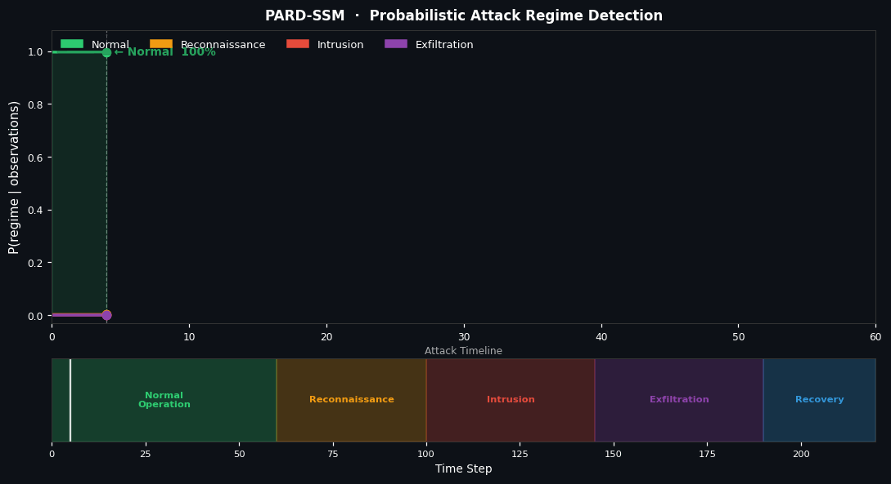
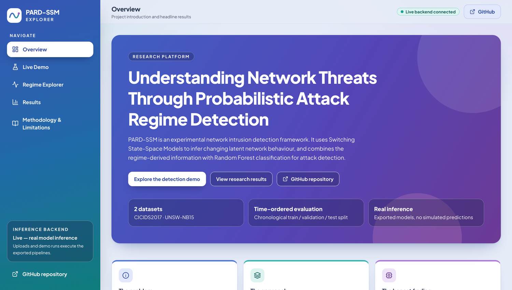
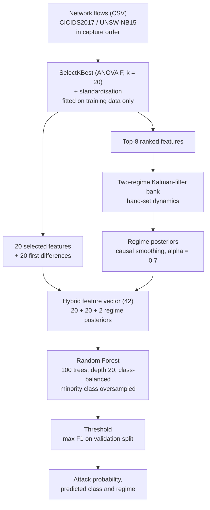

<div align="center">


<h1>
  
</h1>

<p align="center">
  
  
  
  
  
</p>

<p align="center">
  <a href="https://github.com/Sahilbhekane/PARD-in-Network-Traffic-using-Switching-State-Space-Models-/actions/workflows/ci.yml"></a>
  <a href="https://pard-ssm-probabilistic-attack-regim.vercel.app/"></a>
  
  
  <a href="https://arxiv.org/abs/2604.02299"></a>
  <a href="https://doi.org/10.5281/zenodo.19697928"></a>
</p>

<p align="center">
  <b>Modelling multi-stage cyber attacks in network telemetry<br>
  as probabilistic switching dynamical systems, evaluated in time order.</b>
</p>

<p align="center">
  <a href="https://pard-ssm-probabilistic-attack-regim.vercel.app/"><b>Live demo</b></a> ·
  <a href="#results"><b>Results</b></a> ·
  <a href="#installation-and-quick-start"><b>Quick start</b></a> ·
  <a href="docs/Final_Report.pdf"><b>Final report (PDF)</b></a> ·
  <a href="#contributors"><b>Contributors</b></a> ·
  <a href="#citation"><b>Citation</b></a>
</p>

<br>



<sub><i>Illustrative animation: the model tracks regime probabilities as network telemetry arrives.</i></sub>

<br><br>

<table>
  <tr>
    <td align="center"><h2>0.993</h2><sub>ROC-AUC (hybrid, both datasets)</sub></td>
    <td align="center"><h2>2</h2><sub>benchmarks: CICIDS2017, UNSW-NB15</sub></td>
    <td align="center"><h2>60/20/20</h2><sub>chronological split, 20-row embargo</sub></td>
    <td align="center"><h2>28</h2><sub>automated tests</sub></td>
  </tr>
</table>

</div>

---

## What is PARD-SSM?

Most intrusion detection systems classify every network flow in isolation, so two flows with identical features get the same decision no matter what came before. Real attacks are not isolated events: they unfold as phases such as probing, exploitation and data transfer, and the statistical character of the traffic changes from one phase to the next.

**PARD-SSM takes a different approach.** It models network traffic as a *hidden dynamical system*: the true network condition is a latent variable that must be inferred, over time, from noisy, high-dimensional observations. A discrete **regime** follows a Markov chain and selects the dynamics of a continuous hidden state. A Random Forest then combines the regime posteriors with the flow features to output a **probability of attack** for every step.

This repository contains the original research implementation **and** the project's time-ordered reproduction: a leakage-free evaluation on CICIDS2017 and UNSW-NB15 with a component ablation, class-wise analysis, exported models, a FastAPI inference service and a public web application, **PARD-SSM Explorer**.

> [!IMPORTANT]
> This is an offline research project on benchmark data from 2015 and 2017. It is **not** a production security tool. The reproduced evaluation found that the switching-SSM regime features carry signal but **do not improve** on a Random Forest alone, and it makes **no early-detection claim**.

---

## Key Features

- **Probabilistic regime tracking.** Outputs regime posteriors and an attack probability at every time step, not just a binary alert.
- **Four inference engines.** Kalman Filter, EKF, UKF and a Variational Switching KF (GPB2 + Viterbi + EM), from simple baselines to the full switching model.
- **Hybrid detector.** Two-regime Kalman-filter bank + Random Forest on 42 features (20 selected, 20 temporal differences, 2 regime posteriors).
- **Leakage-free, chronological evaluation.** Order-preserving splits, training-only feature selection and scaling, validation-selected threshold, single evaluation on the held-out test partition.
- **Honest ablation.** RF only, plus differences, plus SSSM posteriors, and the regime posterior on its own, with class-wise analysis.
- **Deployed.** Exported pipelines, a FastAPI backend and the React-based **PARD-SSM Explorer** with real model inference.
- **Benchmark evaluated.** CICIDS2017 and UNSW-NB15, the two most widely used intrusion detection benchmarks.
- **Fully tested.** 28 automated tests and CI on Python 3.10, 3.11 and 3.12.

---

## PARD-SSM Explorer

Run the trained pipelines on a demo sample or your own CSV and inspect the inferred regimes. Predictions come from the real exported models (no simulated outputs).

**[Open the live Explorer →](https://pard-ssm-probabilistic-attack-regim.vercel.app/)**

<table>
  <tr>
    <td width="50%"></td>
    <td width="50%"></td>
  </tr>
  <tr>
    <td align="center"><sub><b>Overview</b>: problem, approach, headline held-out results</sub></td>
    <td align="center"><sub><b>Live Demo</b>: demo sample or CSV upload, per-row attack probability</sub></td>
  </tr>
  <tr>
    <td width="50%"></td>
    <td width="50%"></td>
  </tr>
  <tr>
    <td align="center"><sub><b>Regime Explorer</b>: regimes are neutral filter states, not attack families</sub></td>
    <td align="center"><sub><b>Methodology &amp; Limitations</b>: model, pipeline, caveats</sub></td>
  </tr>
</table>

> The hosted backend runs on a free-tier instance that sleeps when idle, so the first request after a quiet period can take up to a minute. If it is unreachable, the site falls back to clearly labelled *precomputed* results.

---

## Attack Regime Modeling

Cyber attacks follow structured multi-stage progressions, which the original model design aligns with the **MITRE ATT&CK** framework:

| # | Regime | Observable Signals |
|---|--------|--------------------|
| 0 | 🟢 **Normal Operation** | Stable flows, known protocols, predictable rates |
| 1 | 🟡 **Reconnaissance** | Port sweeps, DNS enumeration, SYN floods |
| 2 | 🔴 **Intrusion Attempts** | Auth failures, unusual service access |
| 3 | 🟠 **Privilege Escalation** | Admin logins, policy changes, new accounts |
| 4 | 🔵 **Lateral Movement** | Unexpected internal connection spikes |
| 5 | 🟣 **Data Exfiltration** | Large outbound flows, unusual destinations |

> [!NOTE]
> The table above is the **conceptual design** of the research model. The reproduced, deployed pipeline uses **two hand-set regimes** (low-noise and high-noise dynamics). These are neutral filter states and were **not** validated against attack stages or attack families.

---

## Mathematical Formulation

The system is a **Switching State-Space Model (SSSM)**: both the continuous hidden network state and the discrete regime must be inferred from observations.

$$
x_t = A_{s_t}\, x_{t-1} + w_t, \quad w_t \sim \mathcal{N}(0, Q_{s_t}) \qquad\text{(regime-specific state dynamics)}
$$

$$
y_t = C_{s_t}\, x_t + v_t, \quad v_t \sim \mathcal{N}(0, R_{s_t}) \qquad\text{(observation model)}
$$

$$
P(s_t = j \mid s_{t-1} = i) = \pi_{ij} \qquad\text{(regime transitions, first-order Markov chain)}
$$

The inference goal is the joint posterior $P(x_t, s_t \mid y_{1:t})$: regime probabilities plus a hidden-state estimate. In the research implementation $\Pi$ is learned from data via EM; in the reproduced pipeline it is fixed (stay probabilities 0.90 and 0.85). Full derivations (KF → RTS smoother → GPB2 → Viterbi) are in [`docs/math_derivations.md`](docs/math_derivations.md). The dependency structure is in [`docs/figures/graphical_model.png`](docs/figures/graphical_model.png).

### Reproduced pipeline



| Component | Configuration |
| :-- | :-- |
| Regime 1 | $A = 0.95\,I$, $Q = 0.001\,I$ (near-stationary, low noise) |
| Regime 2 | $A = 1.5\,I$, $Q = 0.5\,I$ (high gain, high noise) |
| Observation model | $C = I$, $R = 0.2\,I$ (both regimes) |
| Regime transitions | Fixed stay probabilities 0.90 and 0.85 |
| Posterior smoothing | Causal exponential smoothing, $\alpha = 0.7$ |
| Parameter learning | **None** (all values hand-set) |
| Classifier | Random Forest, 100 trees, max depth 20, class-balanced |

<details>
<summary><b>Research model architecture (original design)</b></summary>

<br/>

```
Raw Network Telemetry  (PCAP / NetFlow / CICIDS CSV)
              │
              ▼
    ┌─────────────────────┐
    │  Feature Extraction  │   packet stats · flow metadata · protocol ratios
    └──────────┬──────────┘
               │  Normalize → PCA → Sliding Window
               ▼
    ┌─────────────────────────────────────────────┐
    │          Switching State-Space Model        │
    │                                             │
    │   Hidden State   x_t  ∈ ℝᵈ                  │
    │   Regime         s_t  ∈ {0, …, K-1}         │
    │   Transition     Π    (learned via EM)      │
    └──────────────────┬──────────────────────────┘
                       │
             Inference Engine
                       │
         ┌─────────────┼──────────────┐
         ▼             ▼              ▼
    Kalman Filter    EKF / UKF    Variational
    (linear SSM)   (nonlinear)   Switching KF
                                      │
                                      ▼
                       Regime Probabilities P(s_t | y_{1:t})
```

</details>

---

## Inference Methods

| Method | Model Type | Key Property | Complexity |
|--------|-----------|--------------|------------|
| **Kalman Filter (KF)** | Linear Gaussian | Exact posterior, fast baseline | Low |
| **Extended KF (EKF)** | Nonlinear | Local Jacobian linearization | Medium |
| **Unscented KF (UKF)** | Nonlinear | Sigma-point transform, no Jacobians needed | Medium-High |
| **Variational Switching KF** | Full SSSM | GPB2 approximation + Viterbi + EM learning | High |

All methods output the filtered state estimate $x_{t|t}$ and covariance $P_{t|t}$, the regime probability vector $P(s_t \mid y_{1:t})$, the Viterbi-decoded most-likely regime path, and the log-likelihood for model comparison.

---

## Results

All numbers below come from the **held-out test partition** of the chronological protocol (single seed, threshold selected on validation). They come from the exported [`artifacts/*/metrics.json`](artifacts) files, and the charts are regenerated by [`scripts/make_figures.py`](scripts/make_figures.py).

| Held-out test | CICIDS2017 | UNSW-NB15 |
| :-- | --: | --: |
| Random Forest only, F1 | **0.924** | 0.834 |
| Hybrid (RF + SSSM), F1 | 0.873 | **0.836** |
| Hybrid, precision / recall | 0.974 / 0.792 | 0.724 / 0.989 |
| Hybrid, ROC-AUC | **0.993** | 0.993 |
| Hybrid, PR-AUC | 0.940 | 0.874 |
| SSSM regime posterior alone, ROC-AUC | 0.804 | 0.915 |
| Decision threshold (max F1 on validation) | 0.654 | 0.269 |

**What this shows**

1. The regime posterior is informative on its own (ROC-AUC 0.804 / 0.915), but that information is **largely redundant** with the flow features the Random Forest already uses.
2. On CICIDS2017 the Random Forest alone is **0.050 F1 ahead** of the hybrid; on UNSW-NB15 the two are tied within noise.
3. Detection is uneven across attack classes: DDoS is caught almost always, DoS GoldenEye only about 40% of the time, and none of the 7 Bot rows is detected.
4. The evaluation protocol matters: the original shuffled-split experiments reported F1 of 0.961 / 0.944, far above the chronological results.

<p align="center">
  
</p>

<details>
<summary><b>Ablation on the held-out test partition</b> (click to expand)</summary>

<br/>

**CICIDS2017**: 10,620 test rows, 5.3% attacks (about 560 attack rows)

| Variant | Precision | Recall | F1 | FPR | ROC-AUC | PR-AUC |
| :-- | --: | --: | --: | --: | --: | --: |
| Random Forest only | 0.971 | 0.881 | **0.924** | 0.001 | 0.989 | **0.952** |
| RF + temporal differences | 0.945 | 0.819 | 0.877 | 0.003 | 0.991 | 0.936 |
| Hybrid: RF + differences + SSSM posteriors | **0.974** | 0.792 | 0.873 | 0.001 | **0.993** | 0.940 |

**UNSW-NB15**: 8,560 test rows, 6.2% attacks

| Variant | Precision | Recall | F1 | FPR | ROC-AUC | PR-AUC |
| :-- | --: | --: | --: | --: | --: | --: |
| Random Forest only | **0.728** | 0.977 | 0.834 | **0.024** | **0.995** | **0.916** |
| RF + temporal differences | 0.720 | **0.992** | 0.835 | 0.026 | 0.993 | 0.874 |
| Hybrid: RF + differences + SSSM posteriors | 0.724 | 0.989 | **0.836** | 0.025 | 0.993 | 0.874 |


With one seed and one split, differences of a few hundredths are within noise (see [`experiments/statistical_significance.py`](experiments/statistical_significance.py)).

</details>

<details>
<summary><b>Class-wise detection and confusion matrices</b> (click to expand)</summary>

<br/>


The CICIDS2017 test partition contains only 17 SSH-Patator and 7 Bot rows, so those rates are statistically unreliable. On UNSW-NB15 most families have fewer than 30 test rows.


*ROC (AUC 0.993) and precision-recall (AP 0.940) curves of the hybrid model on CICIDS2017.*

</details>

<details>
<summary><b>Original repository-reported results (not reproduced)</b> (click to expand)</summary>

<br/>

> [!WARNING]
> These come from the earlier research code, which randomly sampled 50,000 rows **before** an 80/20 split and stored them in shuffled order. A diagnostic confirmed that a flow's label is no more likely to match its predecessor's than chance, so sequence-based metrics, including **detection lead time**, are not temporally meaningful. The processed arrays also cannot be regenerated by the current loader. They are kept for transparency only and are **not comparable** to the table above.

| Metric (hybrid, threshold 0.5) | CICIDS2017 | UNSW-NB15 |
| :-- | --: | --: |
| Accuracy | 98.41% | 99.75% |
| Attack precision | 93.95% | 90.13% |
| Attack recall | 98.28% | 99.06% |
| F1-score | 0.9607 | 0.9438 |
| ROC-AUC | 0.9981 | 0.9996 |
| PR-AUC | 0.9937 | 0.9823 |

**Baselines** (original configuration, shuffled split, 10-epoch LSTM; not re-run chronologically)

| Method | CICIDS2017 F1 | CICIDS2017 ROC-AUC | UNSW-NB15 F1 | UNSW-NB15 ROC-AUC |
| :-- | --: | --: | --: | --: |
| HMM | 0.0719 | 0.4947 | 0.0314 | 0.5008 |
| Isolation Forest | 0.4446 | 0.7041 | 0.3004 | 0.9723 |
| LSTM | 0.3273 | 0.5058 | 0.0413 | 0.4975 |
| Switching SSM + RF | 0.9604 | 0.9982 | 0.9438 | 0.9996 |

The hybrid includes a supervised Random Forest while the baselines are fixed-configuration conventional models, so this gap should **not** be attributed to the switching SSM. Figures: [`results/baselines_cicids2017.png`](results/baselines_cicids2017.png), [`results/baselines_unswnb15.png`](results/baselines_unswnb15.png), [`results/ablation_cicids2017.png`](results/ablation_cicids2017.png).

</details>

### Evaluation protocol

| Dataset | Ordering | Features | Partition rows (train / val / test) | Attack share (train / val / test) |
| :-- | :-- | --: | :-- | :-- |
| CICIDS2017 | File order within each daily CSV (no timestamp column) | 52 | 32,327 / 10,617 / 10,620 | 21.0% / 14.3% / 5.3% |
| UNSW-NB15 | Sorted by start time (`Stime`) | 38 | 25,738 / 8,560 / 8,560 | 2.0% / 7.0% / 6.2% |

1. Load raw files in capture order. Order is never shuffled. Any non-benign label is an attack.
2. Drop incomplete or non-finite rows and exact duplicates; take every 47th row of the ordered stream (order-preserving, deterministic).
3. Split chronologically 60 / 20 / 20 inside each CICIDS2017 daily file, and over the whole `Stime`-sorted UNSW-NB15 stream, with a 20-row embargo between splits.
4. Fit feature selection and scaling on **training data only**. Choose the threshold on **validation data only**. Evaluate **once** on the held-out test partition.

<p align="center">
  
</p>

The attack share drops sharply between training and test on CICIDS2017 (21.0% → 5.3%), which shifts the best operating point and is one plausible reason the hybrid under-performs on recall. This was not isolated by a separate experiment.

---

## Evaluation Metrics

| Metric | Description |
|--------|-------------|
| **Precision / Recall / F1** | Attack-class quality at the validation-selected threshold |
| **False-positive rate** | Share of benign rows wrongly flagged |
| **ROC-AUC / PR-AUC** | Threshold-independent measures; PR-AUC is more informative when attacks are rare |
| **Class-wise flag rate** | Recall per attack label and false-alarm rate on benign traffic |
| **Regime Accuracy** | Accuracy of the Viterbi-decoded path vs labels (research code) |
| **Prediction MSE / Log-Likelihood** | One-step-ahead prediction error and held-out model fit (research code) |
| **Detection Lead Time** | Reported only in the original shuffled experiments; **not claimed** |

---

## Repository Structure

```text
.
├── artifacts/                  # exported, independently loadable pipelines
│   ├── cicids2017/             #   feature_selector, scaler, random_forest, switching_ssm (.joblib),
│   └── unswnb15/               #   threshold.json, feature_schema.json, model_config.json,
│                               #   metrics.json, demo_sample.csv
├── assets/                     # banner and social-preview image
├── backend/                    # FastAPI inference service (backend.app.main:app)
│   └── pins.txt                #   library versions the artifacts were trained with
├── frontend/                   # PARD-SSM Explorer: React + TypeScript + Vite + Tailwind + Recharts
│   ├── src/pages/              #   Overview, Live Demo, Regime Explorer, Results, Methodology
│   └── public/                 #   precomputed fallback results and sample CSVs
├── docs/
│   ├── Final_Report.pdf        # project report (VTU, 2026-27)
│   ├── dataset_guide.md        # dataset download + synthetic data fallback
│   ├── math_derivations.md     # KF → RTS → GPB2 → Viterbi derivations
│   ├── regime_detection.gif    # README animation
│   └── figures/                # result charts and Explorer screenshots
├── experiments/
│   ├── run_baseline.py         # KF / EKF / UKF comparison
│   ├── run_switching.py        # full SSSM end-to-end experiment
│   ├── evaluation_metrics.py   # unified comparison table
│   ├── baselines.py            # HMM / Isolation Forest / LSTM baselines
│   ├── ablation_study.py       # component ablation
│   └── statistical_significance.py
├── results/                    # figures and significance outputs
├── scripts/
│   ├── export_artifacts.py     # train, evaluate, export and verify one dataset
│   └── make_figures.py         # regenerate docs/figures from artifacts/*/metrics.json
├── src/
│   ├── data_processing/        # dataset_loader, feature_engineering, loaders_v2 (order-preserving)
│   ├── pipeline/hybrid.py      # shared training / inference code of the hybrid pipeline
│   ├── inference/              # kalman_filter, ekf, ukf, variational_switching (GPB2 + Viterbi + EM)
│   ├── models/                 # linear_ssm, nonlinear_ssm, switching_ssm
│   ├── explainablity/          # optional SHAP analysis (directory name kept for import compatibility)
│   └── utils/                  # metrics, visualisation
├── tests/                      # Kalman filter, switching SSM, data processing, API
├── .github/                    # CI workflow, issue and PR templates
├── requirements.txt            # full research environment
├── requirements-dev.txt        # lightweight: API + tests + figures
├── CITATION.cff · CHANGELOG.md · CONTRIBUTING.md
└── LICENSE
```

Raw datasets, processed arrays and temporary outputs are excluded from version control. The exported artifacts (about 3 MB) are committed so the API runs without retraining.

---

## Installation and Quick Start

Requires **Python 3.10+** (and **Node.js 18+** for the web app).

```bash
# 1. Clone the repository
git clone https://github.com/Sahilbhekane/PARD-in-Network-Traffic-using-Switching-State-Space-Models-.git
cd PARD-in-Network-Traffic-using-Switching-State-Space-Models-

# 2. Create a virtual environment (recommended)
python -m venv venv
source venv/bin/activate          # Mac / Linux
venv\Scripts\activate             # Windows
```

**Option A: inference API and tests** (lightweight, pinned versions)

```bash
pip install -r requirements-dev.txt
python -m pytest -q                              # 28 tests
uvicorn backend.app.main:app --port 8000         # interactive docs: http://localhost:8000/docs
```

```bash
curl http://localhost:8000/api/health
curl -X POST http://localhost:8000/api/predict -F dataset=cicids2017 -F use_demo=true
curl -X POST http://localhost:8000/api/predict -F dataset=unswnb15 -F file=@my_traffic.csv
```

| Endpoint | Purpose |
| :-- | :-- |
| `GET /api/health` | Backend status and per-dataset model availability |
| `GET /api/demo` | Datasets, feature schemas, thresholds, reported metrics, regime definitions |
| `POST /api/predict` | Validates input, runs the dataset-specific pipeline, returns predictions, probabilities and regime timelines (plus metrics when a `Label` column is supplied) |

Uploads need a header row with the dataset's exact feature columns ([`artifacts/<dataset>/feature_schema.json`](artifacts)), numeric finite values, rows in capture order, and at most 5,000 rows / 10 MB. Incompatible files are rejected with an explanatory error; rows are never silently dropped because order matters.

**Option B: the full Explorer locally**

```bash
# terminal 1: backend (from the repository root, with Option A installed)
uvicorn backend.app.main:app --port 8000

# terminal 2: frontend
cd frontend
cp .env.example .env              # VITE_API_BASE=http://localhost:8000
npm install
npm run dev                       # http://localhost:5173
```

To allow other browser origins, set `ALLOWED_ORIGINS` (comma-separated) before starting the backend.

**Option C: full research environment** (adds PyTorch for the LSTM baseline, plotting and other research libraries)

```bash
pip install -r requirements.txt
```

---

## Running the Pipeline

### Reproduce the chronological results

Download the datasets as described in [`docs/dataset_guide.md`](docs/dataset_guide.md) and place them under `data/raw/` (CICIDS2017 daily CSVs; `UNSW-NB15_1.csv` to `UNSW-NB15_4.csv`).

```bash
# 1. Train, evaluate on the held-out partition, export, and re-verify one dataset's pipeline
python scripts/export_artifacts.py --dataset cicids2017
python scripts/export_artifacts.py --dataset unswnb15
#    options: --raw <dir>  --stride 47  --trees 100  --out artifacts

# 2. Regenerate the result figures from the exported metrics
python scripts/make_figures.py
```

Each export reloads the saved pipeline and checks that it reproduces the held-out predictions exactly. Results are deterministic for the same raw files and library versions (`random_state = 42`; versions in [`backend/pins.txt`](backend/pins.txt)).

### Quick start with synthetic data (no download needed)

```python
# generate_synthetic.py
import numpy as np

X = np.vstack([
    np.random.randn(800, 10) * 0.5,           # Normal traffic
    np.random.randn(600, 10) * 2.0 + 3.0,    # Scanning / attack
    np.random.randn(600, 10) * 1.0 - 2.0,    # Exfiltration
])
y = np.array([0]*800 + [1]*600 + [2]*600)

np.save("data/processed/synthetic_features.npy", X)
np.save("data/processed/synthetic_labels.npy",   y)
```

```bash
python experiments/run_switching.py \
    --data   data/processed/synthetic_features.npy \
    --labels data/processed/synthetic_labels.npy   \
    --regimes 3
```

<details>
<summary><b>Original research experiments on CICIDS2017 (shuffled-split protocol)</b></summary>

<br/>

```bash
# Step 1: preprocess the raw dataset
python src/data_processing/dataset_loader.py \
    --dataset cicids2017 \
    --input   data/raw/cicids2017/ \
    --output  data/processed/

# Step 2: baseline filters (KF / EKF / UKF)
python experiments/run_baseline.py \
    --data   data/processed/cicids2017_features.npy \
    --labels data/processed/cicids2017_labels.npy

# Step 3: full Switching SSM
python experiments/run_switching.py \
    --data     data/processed/cicids2017_features.npy \
    --labels   data/processed/cicids2017_labels.npy   \
    --regimes  4   \
    --em-iters 20

# Step 4: compare all methods
python experiments/evaluation_metrics.py

# Conventional baselines, ablation and significance tests
python experiments/baselines.py --dataset cicids2017 --lstm-epochs 10
python experiments/ablation_study.py --dataset cicids2017
python experiments/statistical_significance.py --help
```

These use randomly sampled, shuffled arrays, so their results are **not** chronological detection performance (see the warning in [Results](#results)).

</details>

### Run all tests

```bash
python -m pytest -q
```

---

## Datasets

### CICIDS 2017
- **Source:** [Canadian Institute for Cybersecurity](https://www.unb.ca/cic/datasets/ids-2017.html)
- **Size:** ~1.2 GB, 8 CSV files, one per day of a simulated work week
- **Attacks:** Brute Force, DoS/DDoS, Infiltration, Port Scan, Botnet, Web Attacks
- **Features:** CICFlowMeter flow-level features (52 used by the reproduced pipeline)

### UNSW-NB15
- **Source:** [UNSW Canberra Cyber](https://research.unsw.edu.au/projects/unswnb15-dataset)
- **Size:** ~100 MB, 4 CSV files, ~2.5 million records
- **Attacks:** Fuzzers, Analysis, Backdoors, DoS, Exploits, Generic, Reconnaissance, Shellcode, Worms (9 categories)
- **Features:** 49 features including packet stats, flow metadata and protocol behaviour (38 used by the reproduced pipeline)

> See [`docs/dataset_guide.md`](docs/dataset_guide.md) for full download steps and preprocessing commands. The datasets are not distributed with this repository and remain subject to their own terms of use.

---

## Deployment

The public Explorer uses two independent services:

| Component | Host | Key settings |
| :-- | :-- | :-- |
| Frontend | Vercel | Root directory `frontend`, Vite preset, build `npm run build`, output `dist`, env `VITE_API_BASE=<backend URL>` |
| Backend | Render (free instance) | Build `pip install -r backend/requirements.txt`, start `uvicorn backend.app.main:app --host 0.0.0.0 --port $PORT`, health check `/api/health`, env `ALLOWED_ORIGINS=<frontend URL>` |

The backend loads both pipelines once at startup from the committed artifacts, so nothing depends on files written at runtime. `ALLOWED_ORIGINS` must exactly match the deployed frontend origin (scheme and host, no trailing slash).

---

## Limitations

- **Data preparation.** Both datasets are de-duplicated and sampled (every 47th row), so rare classes such as Heartbleed and Infiltration are largely or entirely absent and the stream is coarser than real traffic.
- **Single seed, single split.** The split is within-session chronological. It does not test generalisation to unseen days or attack families.
- **Ordering proxy.** CICIDS2017 has no timestamp column, so file order stands in for capture order.
- **Small test partitions.** About 560 attack rows on CICIDS2017; UNSW-NB15 has roughly 2% attacks in training against about 6% in test, so its threshold and precision are less reliable.
- **Hand-set model.** The Kalman bank and transition matrix are not learned, and the regimes are not validated attack families.
- **No demonstrated SSSM benefit** over a Random Forest alone in the held-out evaluation.
- **Lead time not claimed.** The earlier lead-time figures came from shuffled data and do not reflect temporal detection.
- **Explorer.** Each request is processed as one independent sequence (at most 5,000 rows) with a fresh filter state, and models accept only the exact feature schema they were trained on. Free-tier hosting means cold starts and no availability guarantee.
- **Deployment.** An attack probability is a model output, not a verified classification. The models are trained on 2015 and 2017 benchmark data.

---

## Future Work

- [ ] Learn the switching-SSM parameters from data (e.g. by EM) and test whether learned regimes help
- [ ] Validate inferred regimes against known attack families; use more than two regimes
- [ ] Evaluate on unseen days, unseen attack families and a second dataset, with multiple seeds and the significance script
- [ ] Calibrate the threshold under prevalence shift; improve rare classes such as DoS GoldenEye and Bot
- [ ] Use real timestamps to measure early detection in seconds
- [ ] Add stronger sequential baselines (GRU, Transformer) trained to convergence
- [ ] Streaming back end for live network monitoring; SIEM integration (Splunk, Elastic Security)
- [ ] Deep Kalman Filter hybrids and unsupervised regime discovery

---

## Contributors

<div align="center">

<a href="https://github.com/Sahilbhekane/PARD-in-Network-Traffic-using-Switching-State-Space-Models-/graphs/contributors">
  
</a>

<br><br>

<table>
  <tr>
    <td align="center" width="170">
      <a href="https://github.com/prakulhiremath"></a><br>
      <b>Prakul Sunil Hiremath</b><br><sub>2VX23CS013</sub><br><sub>Lead · inference engines &amp; core models</sub>
    </td>
    <td align="center" width="170">
      <a href="https://github.com/PeerAhammad"></a><br>
      <b>PeerAhammad M. Bagawan</b><br><sub>2VX23CS029</sub><br><sub>Data processing, evaluation pipeline, Explorer</sub>
    </td>
    <td align="center" width="170">
      <a href="https://github.com/Sahilbhekane"></a><br>
      <b>Sahil Bhekane</b><br><sub>2VX23CS042</sub><br><sub>Experiments, testing &amp; benchmarking</sub>
    </td>
    <td align="center" width="170">
      <br>
      <b>Hemanth B. K.</b><br><sub>2VX23CS012</sub><br><sub>Visualisation &amp; documentation</sub>
    </td>
    <td align="center" width="170">
      <br>
      <b>Dr. Rashmi R. Rachh</b><br><sub>Project guide</sub><br><sub>Supervision &amp; guidance</sub>
    </td>
  </tr>
</table>

**Institution:** Visvesvaraya Technological University, Belagavi, Karnataka, India<br>
**Programme:** B.E./B.Tech Computer Science &amp; Engineering · Major Project 2026–27

<sub>The graph above lists everyone with commits in this repository; the cards credit every team member, including contributions that are not code (documentation, visualisation, supervision).</sub>

</div>

Want to contribute? See [`CONTRIBUTING.md`](CONTRIBUTING.md).

---

## Citation

If you use this work in your research, please cite the original preprint (GitHub also shows a *Cite this repository* button, from [`CITATION.cff`](CITATION.cff)):

```bibtex
@article{hiremath2026pard,
  title   = {PARD-SSM: Probabilistic Cyber-Attack Regime Detection via Variational Switching State-Space Models},
  author  = {Hiremath, Prakul Sunil and Bagawan, PeerAhammad M and Bhekane, Sahil},
  journal = {arXiv preprint arXiv:2604.02299},
  year    = {2026}
}
```

---

## References

- Ghahramani, Z. & Hinton, G.E. (1996). *Switching State-Space Models.* University of Toronto.
- Murphy, K.P. (1998). *Switching Kalman Filters.* Compaq Cambridge Research Laboratory, Technical Report 98-10.
- Shumway, R.H. & Stoffer, D.S. (1991). *Dynamic linear models with switching.* Journal of the American Statistical Association.
- Breiman, L. (2001). *Random forests.* Machine Learning.
- Sommer, R. & Paxson, V. (2010). *Outside the closed world: On using machine learning for network intrusion detection.* IEEE S&P.
- MITRE Corporation. *ATT&CK® Framework for Enterprise.* https://attack.mitre.org
- Sharafaldin, I. et al. (2018). *Toward Generating a New Intrusion Detection Dataset.* ICISSP.
- Moustafa, N. & Slay, J. (2015). *UNSW-NB15: A Comprehensive Dataset.* MilCIS.

The full reference list is in the [final report](docs/Final_Report.pdf).

---

## License

Copyright 2026 Prakul Sunil Hiremath, PeerAhammad M. Bagawan, Sahil Bhekane, Hemanth B. K., Dr. Rashmi R. Rachh.

Licensed under the **Apache License, Version 2.0**. See [LICENSE](LICENSE) for full terms.

```
Licensed under the Apache License, Version 2.0 (the "License");
you may not use this file except in compliance with the License.
You may obtain a copy of the License at

    http://www.apache.org/licenses/LICENSE-2.0
```

<div align="center">


<sub>Built for early cyber-attack research · VTU Major Project 2026–27 · Research demonstration, not a production security tool</sub>

</div>
