<div align="center">

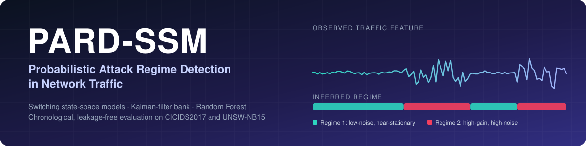

<br/>


[](LICENSE)
[](https://pard-ssm-probabilistic-attack-regim.vercel.app/)
[](https://arxiv.org/abs/2604.02299)
[](https://doi.org/10.5281/zenodo.19697928)

**A time-ordered, leakage-free reproduction and re-evaluation of PARD-SSM, a switching state-space approach to network intrusion detection, on CICIDS2017 and UNSW-NB15.**

[**Live demo**](https://pard-ssm-probabilistic-attack-regim.vercel.app/) ·
[**Results**](#results) ·
[**Quick start**](#quick-start) ·
[**Final report (PDF)**](docs/Final_Report.pdf) ·
[**Citation**](#citation)

</div>

---

## Highlights

- **Switching state-space + Random Forest pipeline.** A two-regime Kalman-filter bank infers latent traffic regimes; a Random Forest combines the regime posteriors with selected flow features and their temporal differences.
- **Chronological evaluation.** Train / validation / test splits follow capture order (60 / 20 / 20, with a 20-row embargo). Feature selection and scaling are fitted on training data only, and the decision threshold is chosen on validation data only.
- **Honest ablation.** Each component is measured separately: Random Forest only, plus temporal differences, plus SSSM regime posteriors, and the regime posterior on its own.
- **Reproducible and deployable.** The pipeline, exported models, FastAPI backend and public web app, **PARD-SSM Explorer**, live in the [team repository](https://github.com/PeerAhammad/PARD-SSM-Probabilistic-Attack-Regime-Detection); this repository holds the original research implementation, the project report and the documentation.
- **Negative results are reported as such.** Under chronological evaluation the SSSM regime features carry signal but do **not** improve on a Random Forest alone.

> [!IMPORTANT]
> This is an offline research reproduction on benchmark data from 2015 and 2017. It is **not** a production security tool, and it makes **no early-detection claim**.

## Results

All numbers below come from the **held-out test partition** of the chronological protocol (single seed, threshold selected on validation). They come from the exported [`metrics.json`](https://github.com/PeerAhammad/PARD-SSM-Probabilistic-Attack-Regime-Detection/tree/main/artifacts) files in the team repository.

| Held-out test | CICIDS2017 | UNSW-NB15 |
| :-- | --: | --: |
| Random Forest only, F1 | **0.924** | 0.834 |
| Hybrid (RF + SSSM), F1 | 0.873 | **0.836** |
| Hybrid, precision / recall | 0.974 / 0.792 | 0.724 / 0.989 |
| Hybrid, ROC-AUC | **0.993** | 0.993 |
| Hybrid, PR-AUC | 0.940 | 0.874 |
| SSSM regime posterior alone, ROC-AUC | 0.804 | 0.915 |
| Decision threshold (max F1 on validation) | 0.654 | 0.269 |

**What this shows**

1. The regime posterior is informative on its own (ROC-AUC 0.804 / 0.915), but that information is **largely redundant** with the flow features the Random Forest already uses.
2. On CICIDS2017 the Random Forest alone is **0.050 F1 ahead** of the hybrid; on UNSW-NB15 the two are tied within noise.
3. Detection is uneven across attack classes: DDoS is caught almost always, DoS GoldenEye only about 40% of the time, and none of the 7 Bot rows is detected.
4. Evaluation protocol matters: the original shuffled-split experiments reported F1 of 0.961 / 0.944, far above the chronological results.

<p align="center">
  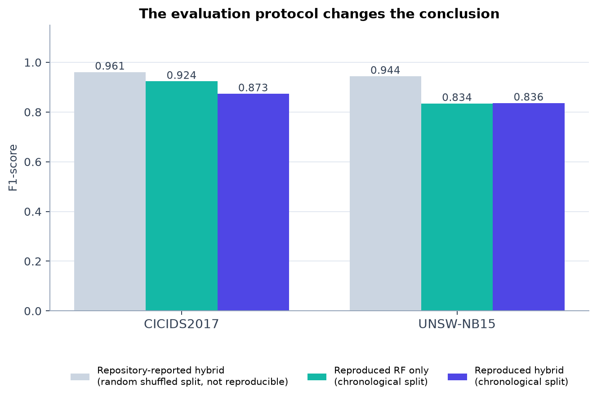
</p>

<details>
<summary><b>Ablation on the held-out test partition</b> (click to expand)</summary>

<br/>

**CICIDS2017**: 10,620 test rows, 5.3% attacks (about 560 attack rows)

| Variant | Precision | Recall | F1 | FPR | ROC-AUC | PR-AUC |
| :-- | --: | --: | --: | --: | --: | --: |
| Random Forest only | 0.971 | 0.881 | **0.924** | 0.001 | 0.989 | **0.952** |
| RF + temporal differences | 0.945 | 0.819 | 0.877 | 0.003 | 0.991 | 0.936 |
| Hybrid: RF + differences + SSSM posteriors | **0.974** | 0.792 | 0.873 | 0.001 | **0.993** | 0.940 |

**UNSW-NB15**: 8,560 test rows, 6.2% attacks

| Variant | Precision | Recall | F1 | FPR | ROC-AUC | PR-AUC |
| :-- | --: | --: | --: | --: | --: | --: |
| Random Forest only | **0.728** | 0.977 | 0.834 | **0.024** | **0.995** | **0.916** |
| RF + temporal differences | 0.720 | **0.992** | 0.835 | 0.026 | 0.993 | 0.874 |
| Hybrid: RF + differences + SSSM posteriors | 0.724 | 0.989 | **0.836** | 0.025 | 0.993 | 0.874 |

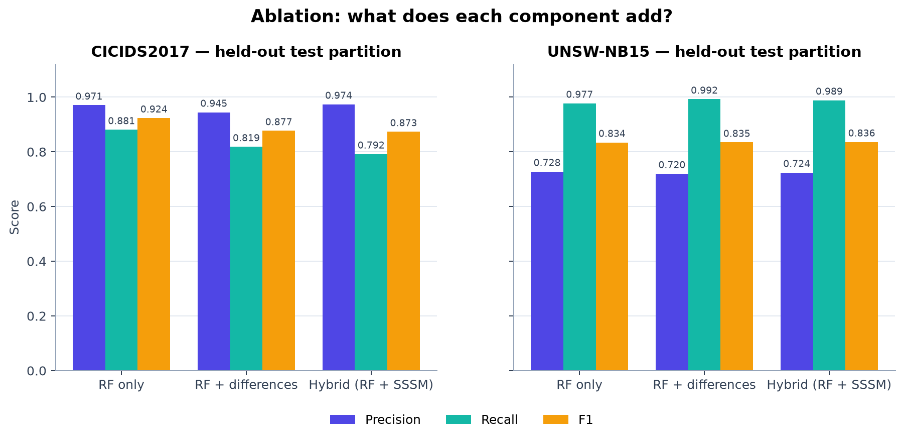

With one seed and one split, differences of a few hundredths are within noise (see [`experiments/statistical_significance.py`](https://github.com/PeerAhammad/PARD-SSM-Probabilistic-Attack-Regime-Detection/blob/main/experiments/statistical_significance.py)).

</details>

<details>
<summary><b>Class-wise detection and confusion matrices</b> (click to expand)</summary>

<br/>

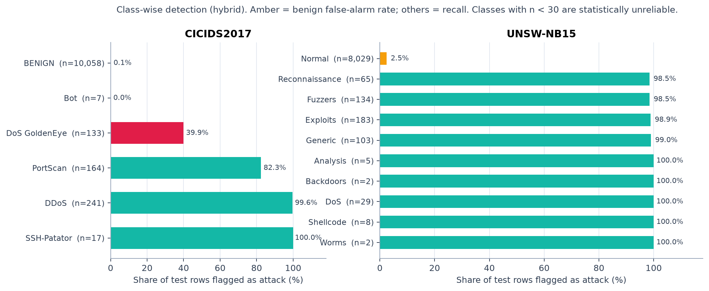

The CICIDS2017 test partition contains only 17 SSH-Patator and 7 Bot rows, so those rates are statistically unreliable. On UNSW-NB15 most families have fewer than 30 test rows.

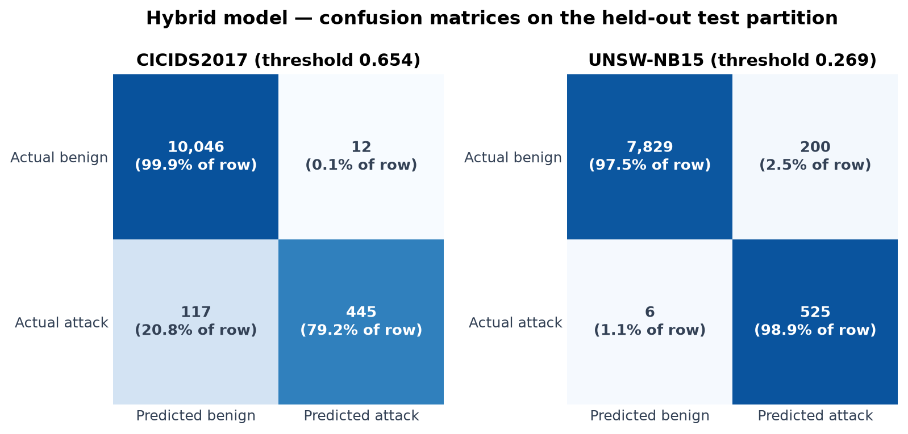

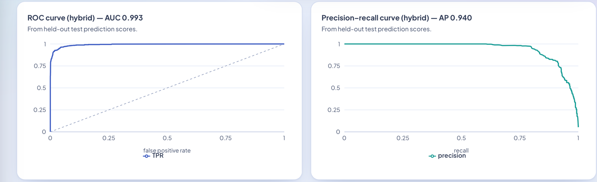

*ROC (AUC 0.993) and precision-recall (AP 0.940) curves of the hybrid model on CICIDS2017.*

</details>

<details>
<summary><b>Original repository-reported results (not reproduced)</b> (click to expand)</summary>

<br/>

> [!WARNING]
> These come from the earlier research code, which randomly sampled 50,000 rows **before** an 80/20 split and stored them in shuffled order. A diagnostic confirmed that a flow's label is no more likely to match its predecessor's than chance, so sequence-based metrics, including **detection lead time**, are not temporally meaningful. The processed arrays also cannot be regenerated by the current loader. They are kept for transparency only and are **not comparable** to the table above.

| Metric (hybrid, threshold 0.5) | CICIDS2017 | UNSW-NB15 |
| :-- | --: | --: |
| Accuracy | 98.41% | 99.75% |
| Attack precision | 93.95% | 90.13% |
| Attack recall | 98.28% | 99.06% |
| F1-score | 0.9607 | 0.9438 |
| ROC-AUC | 0.9981 | 0.9996 |
| PR-AUC | 0.9937 | 0.9823 |

**Baselines** (original configuration, shuffled split, 10-epoch LSTM; not re-run chronologically)

| Method | CICIDS2017 F1 | CICIDS2017 ROC-AUC | UNSW-NB15 F1 | UNSW-NB15 ROC-AUC |
| :-- | --: | --: | --: | --: |
| HMM | 0.0719 | 0.4947 | 0.0314 | 0.5008 |
| Isolation Forest | 0.4446 | 0.7041 | 0.3004 | 0.9723 |
| LSTM | 0.3273 | 0.5058 | 0.0413 | 0.4975 |
| Switching SSM + RF | 0.9604 | 0.9982 | 0.9438 | 0.9996 |

The hybrid includes a supervised Random Forest while the baselines are fixed-configuration conventional models, so this gap should **not** be attributed to the switching SSM. Figures: [`results/baselines_cicids2017.png`](https://github.com/PeerAhammad/PARD-SSM-Probabilistic-Attack-Regime-Detection/blob/main/results/baselines_cicids2017.png), [`results/baselines_unswnb15.png`](https://github.com/PeerAhammad/PARD-SSM-Probabilistic-Attack-Regime-Detection/blob/main/results/baselines_unswnb15.png), [`results/ablation_cicids2017.png`](https://github.com/PeerAhammad/PARD-SSM-Probabilistic-Attack-Regime-Detection/blob/main/results/ablation_cicids2017.png).

</details>

## PARD-SSM Explorer

A research web app with **real model inference** (no simulated predictions): run the trained pipelines on a demo sample or your own CSV, inspect the inferred regimes, and browse the results.

**[Open the live Explorer →](https://pard-ssm-probabilistic-attack-regim.vercel.app/)**

<table>
  <tr>
    <td width="50%"></td>
    <td width="50%">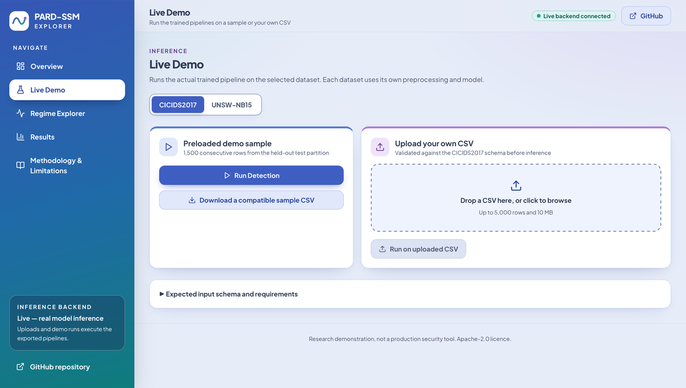</td>
  </tr>
  <tr>
    <td align="center"><sub>Overview: problem, approach, headline held-out results</sub></td>
    <td align="center"><sub>Live Demo: demo sample or CSV upload, per-row attack probability</sub></td>
  </tr>
  <tr>
    <td width="50%">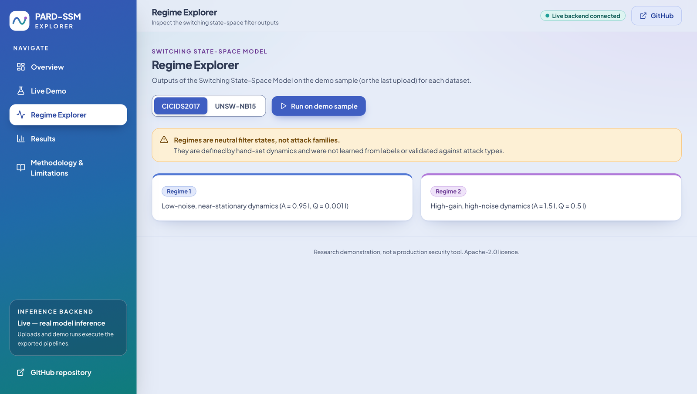</td>
    <td width="50%">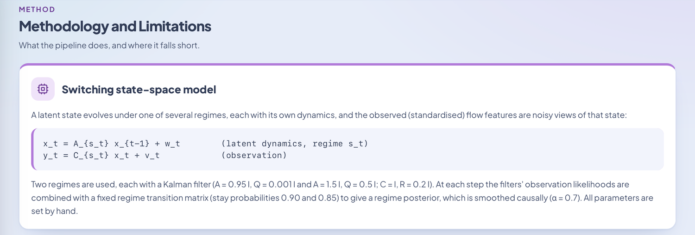</td>
  </tr>
  <tr>
    <td align="center"><sub>Regime Explorer: regimes are neutral filter states, not attack families</sub></td>
    <td align="center"><sub>Methodology &amp; Limitations: model, pipeline, caveats</sub></td>
  </tr>
</table>

> The Explorer's front end and inference API are maintained in the team repository, [PeerAhammad/PARD-SSM-Probabilistic-Attack-Regime-Detection](https://github.com/PeerAhammad/PARD-SSM-Probabilistic-Attack-Regime-Detection). The hosted backend runs on a free-tier instance that sleeps when idle, so the first request after a quiet period can take up to a minute.

## How it works

PARD-SSM treats network traffic as a latent dynamical system whose behaviour switches between discrete regimes, instead of classifying every flow in isolation.

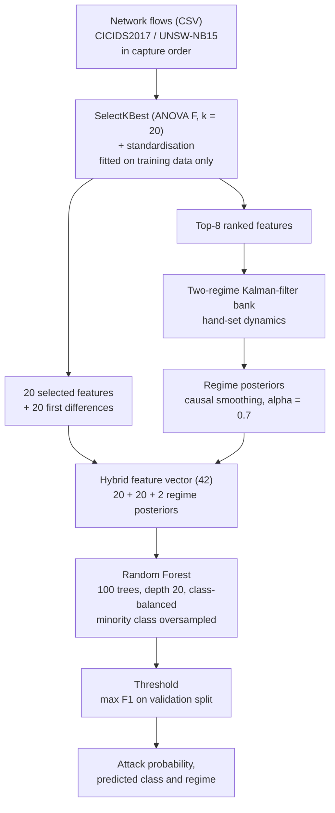

**Model.** A discrete regime $s_t$ follows a first-order Markov chain with transition matrix $\Pi$ and selects the dynamics of a continuous hidden state $x_t$:

$$
x_t = A_{s_t}\, x_{t-1} + w_t, \qquad y_t = C_{s_t}\, x_t + v_t, \qquad \Pi_{ij} = P(s_t = j \mid s_{t-1} = i)
$$

| Component | Configuration in the reproduced pipeline |
| :-- | :-- |
| Regime 1 | $A = 0.95\,I$, $Q = 0.001\,I$ (near-stationary, low noise) |
| Regime 2 | $A = 1.5\,I$, $Q = 0.5\,I$ (high gain, high noise) |
| Observation model | $C = I$, $R = 0.2\,I$ (both regimes) |
| Regime transitions | Fixed stay probabilities 0.90 and 0.85 |
| Posterior smoothing | Causal exponential smoothing, $\alpha = 0.7$ |
| Parameter learning | **None.** All values are hand-set |
| Classifier | Random Forest, 100 trees, max depth 20, class-balanced |

> [!NOTE]
> The two regimes of the reproduced pipeline are **neutral filter states**, not validated attack families. The repository also keeps the original research implementation (Kalman, EKF, UKF and a switching Kalman filter with GPB2, Viterbi decoding and EM learning, in [`src/inference/`](src/inference)). The reproduced evaluation does not use those learned-parameter models.

Full derivations (KF → RTS smoother → GPB2 → Viterbi) are in [`docs/math_derivations.md`](docs/math_derivations.md). The dependency structure is shown in [`docs/figures/graphical_model.png`](docs/figures/graphical_model.png).

## Evaluation protocol

| Dataset | Ordering | Features | Partition rows (train / val / test) | Attack share (train / val / test) |
| :-- | :-- | --: | :-- | :-- |
| CICIDS2017 | File order within each daily CSV (no timestamp column) | 52 | 32,327 / 10,617 / 10,620 | 21.0% / 14.3% / 5.3% |
| UNSW-NB15 | Sorted by start time (`Stime`) | 38 | 25,738 / 8,560 / 8,560 | 2.0% / 7.0% / 6.2% |

1. Load raw files in capture order. Order is never shuffled. Any non-benign label is an attack.
2. Drop incomplete or non-finite rows and exact duplicates; take every 47th row of the ordered stream (order-preserving, deterministic).
3. Split chronologically 60 / 20 / 20 inside each CICIDS2017 daily file, and over the whole `Stime`-sorted UNSW-NB15 stream, with a 20-row embargo between splits.
4. Fit feature selection and scaling on **training data only**. Choose the threshold on **validation data only**. Evaluate **once** on the held-out test partition.

<p align="center">
  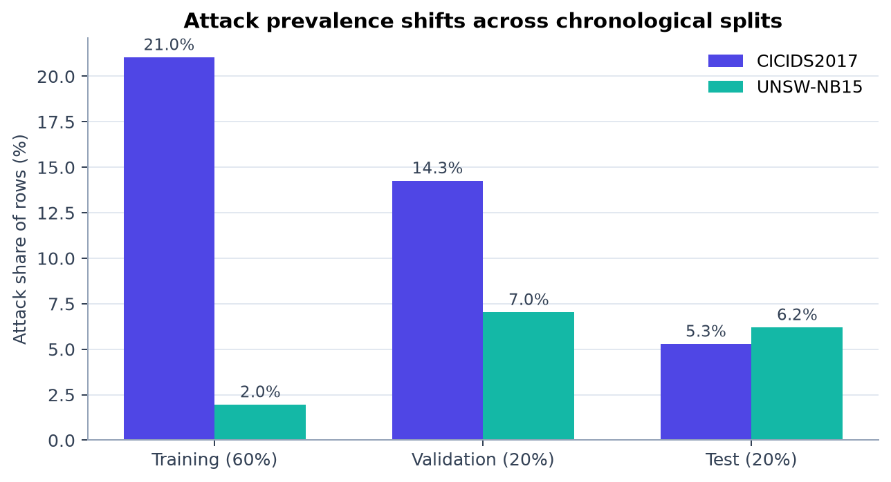
</p>

The attack share drops sharply between training and test on CICIDS2017 (21.0% → 5.3%), which shifts the best operating point and is one plausible reason the hybrid under-performs on recall. This was not isolated by a separate experiment.

## Quick start

Requires **Python 3.10+**.

**Try it online.** Open the [live Explorer](https://pard-ssm-probabilistic-attack-regim.vercel.app/), run a demo sample or upload a CSV, and inspect the regimes. No installation needed.

**Reproduce the chronological results and run the API.** The reproduction pipeline, exported models and backend are in the team repository:

```bash
git clone https://github.com/PeerAhammad/PARD-SSM-Probabilistic-Attack-Regime-Detection.git
cd PARD-SSM-Probabilistic-Attack-Regime-Detection
python -m venv .venv && source .venv/bin/activate      # Windows: .venv\Scripts\Activate.ps1
pip install -r backend/requirements.txt pytest httpx
python -m pytest -q
uvicorn backend.app.main:app --port 8000               # API docs at http://localhost:8000/docs
```

To retrain from the raw datasets (`python scripts/export_artifacts.py --dataset cicids2017`, then `unswnb15`), follow the instructions in that repository's README.

**Run the original research code in this repository.**

```bash
git clone https://github.com/Sahilbhekane/PARD-in-Network-Traffic-using-Switching-State-Space-Models-.git
cd PARD-in-Network-Traffic-using-Switching-State-Space-Models-

python -m venv .venv
source .venv/bin/activate            # Windows (PowerShell): .venv\Scripts\Activate.ps1
pip install -r requirements.txt

python -m pytest -q                  # 21 tests: Kalman filter, switching SSM, data processing
```

No datasets at hand? [`docs/dataset_guide.md`](docs/dataset_guide.md) documents a synthetic three-regime generator for a quick smoke test:

```bash
python experiments/run_switching.py \
    --data   data/processed/synthetic_features.npy \
    --labels data/processed/synthetic_labels.npy \
    --regimes 3
```

<details>
<summary><b>Original experiments on CICIDS2017 (shuffled-split protocol)</b></summary>

<br/>

Download the data as described in [`docs/dataset_guide.md`](docs/dataset_guide.md), then:

```bash
python src/data_processing/dataset_loader.py \
    --dataset cicids2017 --input data/raw/cicids2017/ --output data/processed/

python experiments/run_baseline.py \
    --data data/processed/cicids2017_features.npy --labels data/processed/cicids2017_labels.npy

python experiments/run_switching.py \
    --data data/processed/cicids2017_features.npy --labels data/processed/cicids2017_labels.npy \
    --regimes 4 --em-iters 20

python experiments/evaluation_metrics.py
```

These use randomly sampled, shuffled arrays, so their results are **not** chronological detection performance (see the warning in [Results](#results)).

</details>

## Repository structure

```text
.
├── assets/                     # README banner
├── docs/
│   ├── Final_Report.pdf        # project report (VTU, 2026-27)
│   ├── dataset_guide.md        # dataset download and preparation
│   ├── math_derivations.md     # KF, RTS, GPB2, Viterbi derivations
│   ├── regime_detection.gif    # illustrative animation
│   └── figures/                # result charts and Explorer screenshots
├── experiments/                # baseline, switching-SSM and aggregation scripts
├── results/                    # figures from the original experiments
├── src/
│   ├── data_processing/        # dataset loader, feature engineering
│   ├── inference/              # Kalman, EKF, UKF, switching Kalman filter (GPB2, Viterbi, EM)
│   ├── models/                 # linear / nonlinear / switching SSM
│   ├── explainablity/          # optional SHAP analysis (directory name kept for import compatibility)
│   └── utils/                  # metrics and visualisation helpers
├── tests/                      # Kalman filter, switching SSM, data processing
├── requirements.txt
└── LICENSE
```

The reproduction pipeline (`src/pipeline`), exported models (`artifacts/`), inference API (`backend/`) and the Explorer front end (`frontend/`) are in the [team repository](https://github.com/PeerAhammad/PARD-SSM-Probabilistic-Attack-Regime-Detection).

## Testing

```bash
python -m pytest -q
```

The suite covers the Kalman filter, the switching SSM and data processing.

## Limitations

- **Data preparation.** Both datasets are de-duplicated and sampled (every 47th row), so rare classes such as Heartbleed and Infiltration are largely or entirely absent and the stream is coarser than real traffic.
- **Single seed, single split.** The split is within-session chronological. It does not test generalisation to unseen days or attack families.
- **Ordering proxy.** CICIDS2017 has no timestamp column, so file order stands in for capture order.
- **Small test partitions.** About 560 attack rows on CICIDS2017; UNSW-NB15 has roughly 2% attacks in training against about 6% in test, so its threshold and precision are less reliable.
- **Hand-set model.** The Kalman bank and transition matrix are not learned, and the regimes are not validated attack families.
- **No demonstrated SSSM benefit** over a Random Forest alone in the held-out evaluation.
- **Lead time not claimed.** The earlier lead-time figures came from shuffled data and do not reflect temporal detection.
- **Deployment.** An attack probability is a model output, not a verified classification. The models are trained on 2015 and 2017 benchmark data.

## Roadmap

- [ ] Learn the switching-SSM parameters from data (e.g. by EM) and test whether learned regimes help
- [ ] Validate inferred regimes against known attack families; use more than two regimes
- [ ] Evaluate on unseen days, unseen attack families and a second dataset, with multiple seeds and the significance script
- [ ] Calibrate the threshold under prevalence shift; improve rare classes such as DoS GoldenEye and Bot
- [ ] Use real timestamps to measure early detection in seconds
- [ ] Add stronger sequential baselines (GRU, Transformer) trained to convergence
- [ ] Add a streaming back end for live traffic

## Team

| Name | USN | Contribution |
| :-- | :-- | :-- |
| **Prakul Sunil Hiremath** | 2VX23CS013 | Lead: inference engines and core models |
| **PeerAhammad M. Bagawan** | 2VX23CS029 | Data processing and evaluation pipeline |
| **Sahil Bhekane** | 2VX23CS042 | Experiments, testing and benchmarking |
| **Hemanth B. K.** | 2VX23CS012 | Visualisation and documentation |
| **Dr. Rashmi R. Rachh** | n/a | Project guide |

**Institution:** Visvesvaraya Technological University, Belagavi, Karnataka, India · Department of Computer Science and Engineering · Major Project 2026–27

## Citation

If you use this work, please cite the original preprint:

```bibtex
@article{hiremath2026pard,
  title   = {PARD-SSM: Probabilistic Cyber-Attack Regime Detection via Variational Switching State-Space Models},
  author  = {Hiremath, Prakul Sunil and Bagawan, PeerAhammad M and Bhekane, Sahil},
  journal = {arXiv preprint arXiv:2604.02299},
  year    = {2026}
}
```

## Acknowledgements and attribution

- Datasets: [CICIDS2017](https://www.unb.ca/cic/datasets/ids-2017.html) (Canadian Institute for Cybersecurity) and [UNSW-NB15](https://research.unsw.edu.au/projects/unswnb15-dataset) (UNSW Canberra Cyber).
- The reproduction pipeline, exported artifacts, inference API and web application were developed in the team repository [PeerAhammad/PARD-SSM-Probabilistic-Attack-Regime-Detection](https://github.com/PeerAhammad/PARD-SSM-Probabilistic-Attack-Regime-Detection).
- Methodological references: Murphy (1998) *Switching Kalman Filters*; Shumway and Stoffer (1991) *Dynamic linear models with switching*; Breiman (2001) *Random forests*; Sommer and Paxson (2010) *Outside the closed world*, whose caution about evaluation methodology motivates the chronological protocol. The full reference list is in the [final report](docs/Final_Report.pdf).

## License

Released under the **Apache License 2.0**. See [`LICENSE`](LICENSE).

<div align="center">
<sub>VTU Major Project 2026–27 · Research demonstration, not a production security tool</sub>
</div>
